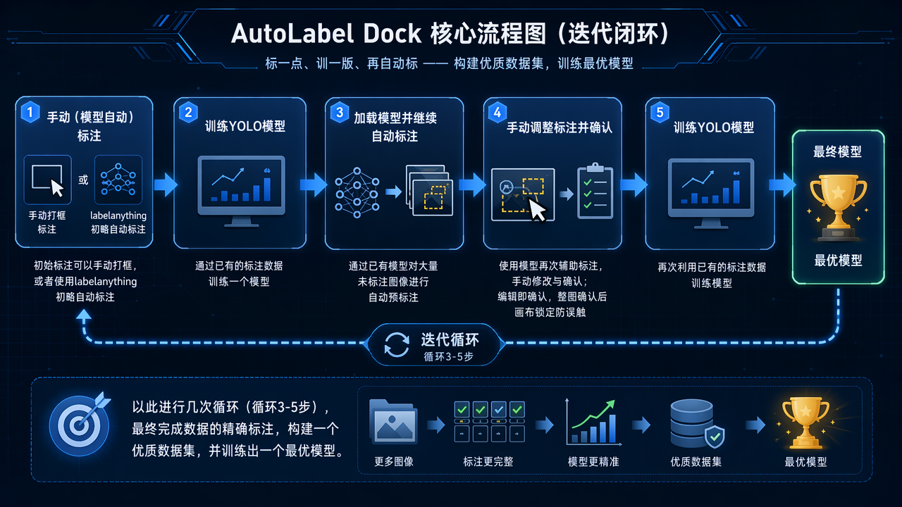
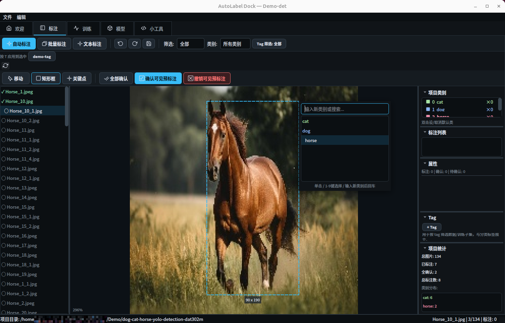
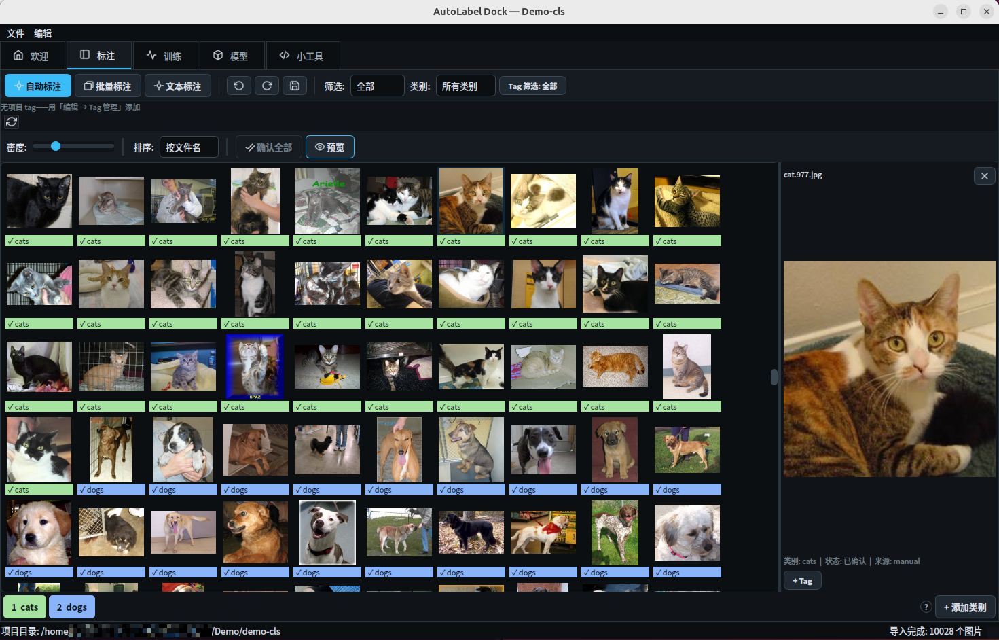
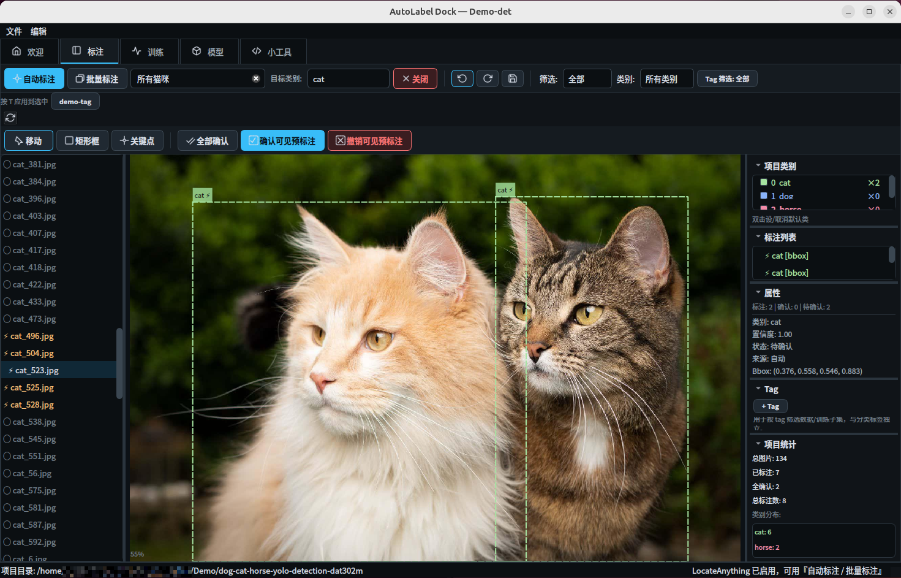
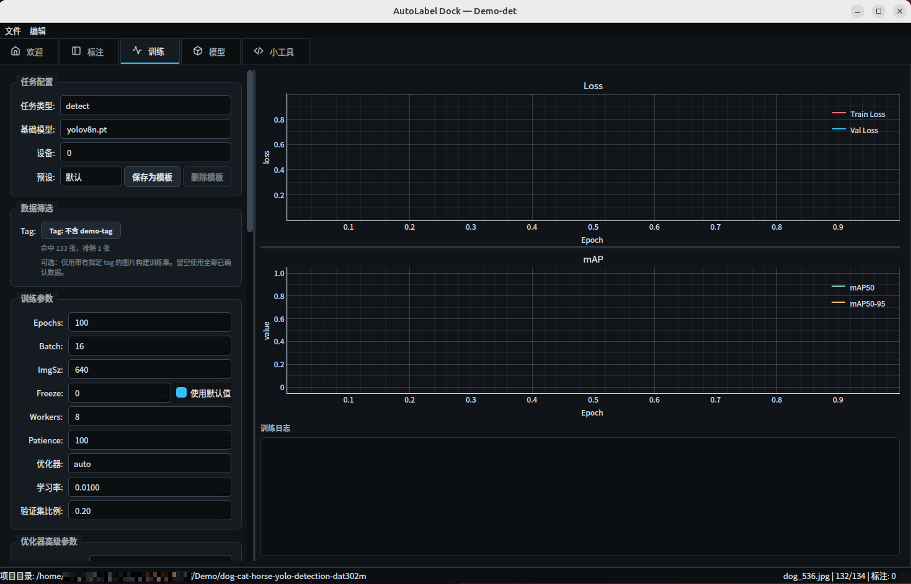
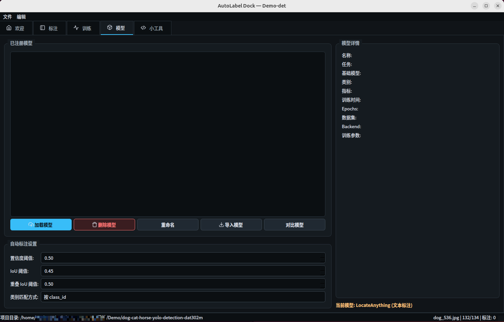

# AutoLabel Dock

> An iterative closed-loop desktop tool for image annotation and YOLO training — annotate a few, train a model, auto-label the rest.


**English** | [简体中文](README.md)


AutoLabel Dock is a desktop image annotation tool built with **PyQt5 + Ultralytics**, featuring a fully Chinese UI, and runs cross-platform on Linux / macOS / Windows.

It turns "annotation" and "training" into an iterative closed loop: manually (or with existing model assistance) annotate a batch of images, confirm them, then train a custom YOLO model with one click. Use the new model to continue auto-labeling the remaining data — with each iteration, fewer manual corrections are needed.




<details>
<summary><b>Screenshots</b></summary>

| Panel | Screenshot |
|:---|:---:|
| Annotation (Detection / Keypoint) |  |
| Classification |  |
| LocateAnything |  |
| Training Panel |  |
| Model Panel |  |

</details>

---

## ✨ Features

- **Three task types** — Object detection (bounding boxes), pose estimation (bounding boxes + keypoint skeletons), image classification (whole-image labels, tag in seconds with `1`–`9`, auto-advances to next image).
- **Keyboard-driven manual annotation** — `W` to draw boxes, `K` to place keypoints, `A`/`D` to switch images, `Space` to confirm; drag to move/resize, scroll to zoom/pan; per-image undo stack, auto-save on image switch.
- **Model-assisted annotation** — Load any YOLOv8 weights for single-image or full-project batch pre-annotation. Pre-annotations appear as yellow dashed "pending" shapes and only count after manual confirmation; overlapping predictions with confirmed annotations are auto-deduplicated by IoU.
- **Text-prompt annotation (optional)** — Integrates NVIDIA LocateAnything-3B for open-vocabulary detection. Describe targets in natural language (e.g., "red hard hat") for pre-annotation without pre-training. The model runs in a separate child process with automatic VRAM management and releases resources on close. (See [Optional: LocateAnything Text Annotation](#optional-locateanything-text-annotation))
- **Built-in training** — One-click YOLO-format dataset generation from confirmed annotations (stratified train/val split), parameter presets, data augmentation preview, real-time loss/mAP curves; auto-registers and loads the trained model for the next annotation round. Zero-copy via symbolic links (auto-degrades on Windows, see [Platform Notes](#platform-notes)).
- **Dataset management** — File list color-coded by annotation status, triple filtering by status / category / labels; apply custom tags to images, filter training subsets by tag; automatic backups before critical operations, rollback anytime.
- **Model management** — Model registry, multi-model metric comparison, model structure viewer (layer-by-layer parameter counts and output shapes to help choose `freeze` layers), import external `.pt` files.
- **Utility panel** — Write and run Python scripts directly within the app (working directory is the current project), handling tasks like batch renaming and data cleaning without switching tools.

---

## 🚀 Quick Start

### Requirements

- Python ≥ 3.10
- NVIDIA GPU recommended for training and inference (CPU-only works, but is slower)
- Text-prompt annotation requires an NVIDIA GPU with ≥ 6 GB VRAM

> 📘 The full environment setup guide (PyTorch CUDA selection, mirrors, LocateAnything backend, packaging into `.exe`, etc.) is in **[INSTALL.md](INSTALL.md)**.

### Installation & Running (Quick Reference)

```bash
git clone https://github.com/Sen-yin/autolabel-dock.git
cd autolabel-dock

# Recommended: use an isolated environment
conda create -n autolabel python=3.10 -y
conda activate autolabel

# 1) Install a CUDA-matched torch FIRST (otherwise pip installs the CPU-only version)
pip install torch torchvision --index-url https://download.pytorch.org/whl/cu121

# 2) Then install the rest of the dependencies
pip install -r requirements.txt

# 3) Launch
python main.py
```

> 💡 For GPU training, follow the [PyTorch website](https://pytorch.org/get-started/locally/) to pick a torch command matching your local CUDA.
> Training base models (e.g., `yolov8n.pt`) are auto-downloaded by Ultralytics on first use. For offline environments, download them in advance and place them in the repo root.

## Optional: LocateAnything Text Annotation

LocateAnything-3B is an optional open-vocabulary detection backend that lets you describe targets in natural language. All other features work normally without it. Enabling it requires all three conditions below; if any is unmet, the UI shows a hint without affecting the app:

<details>
<summary><b>View details</b></summary>

**1. Install optional dependencies**

```bash
pip install -e ".[locateanything]"
```

This additionally installs transformers, accelerate, bitsandbytes, and decord (not included in the base installation).

**2. Download model weights in advance**

The runtime loads with offline mode (`HF_HUB_OFFLINE=1`) and will **not auto-download**. You must manually download `nvidia/LocateAnything-3B` to your local HuggingFace cache:

```bash
hf download nvidia/LocateAnything-3B
# Legacy tool: huggingface-cli download nvidia/LocateAnything-3B
```

The default cache location is `~/.cache/huggingface/hub`. Custom paths can be set via `$HF_HOME` or `$HUGGINGFACE_HUB_CACHE`.

**3. GPU VRAM**

Requires an NVIDIA GPU with `nvidia-smi` available; **CPU is not supported**. Total VRAM ≥ 6 GB, and idle VRAM ≥ 5 GB at launch (desktop display also consumes VRAM on single-GPU machines, hence the higher idle threshold).

> Also: LocateAnything and YOLO models never occupy GPU simultaneously — enabling LocateAnything auto-unloads any loaded YOLO model; the reverse (loading a YOLO model or starting training) first prompts for confirmation to close LocateAnything. It runs in a separate child process, isolated from the main UI process.

</details>

---

## 📖 Basic Workflow

```
1. Create Project  →  2. Import Images  →  3. Annotate  →  4. Confirm  →  5. Train  →  6. Iterate ↻
```

1. **Create Project**: Choose task type (detection / pose / classification), specify a project directory (the project auto-scans and loads images/labels), or leave empty and use the next step to drag in images.
2. **Import Images**: Drag and drop into the window (or later place them into the project `images/` directory and refresh the list); existing annotations can be imported via `Ctrl+I` from YOLO / COCO / labelme formats.
3. **Annotate**: Draw manually; or load YOLO weights for auto pre-annotation; or optionally use the LocateAnything text annotation backend to describe targets in natural language (see [Optional: LocateAnything Text Annotation](#optional-locateanything-text-annotation)).
4. **Confirm**: Review auto-annotation results image by image; any edit counts as confirmation.
5. **Train**: On the training page, choose a base model and parameters (or use presets) → start training → curves update in real time; upon completion the model is auto-registered and loaded.
6. **Iterate**: Use the new model to continue auto-labeling → confirm → train again, until satisfied.

## ⌨️ Shortcuts

| Context | Shortcut | Action |
|:---:|:---|:---|
| General | <kbd>Ctrl</kbd>+<kbd>Z</kbd> / <kbd>Ctrl</kbd>+<kbd>Y</kbd> | Undo / Redo (per-image) |
| General | <kbd>Ctrl</kbd>+<kbd>S</kbd> | Save all changes |
| General | <kbd>Shift</kbd>+<kbd>A</kbd> / <kbd>Ctrl</kbd>+<kbd>Shift</kbd>+<kbd>A</kbd> | Auto-label current image / Batch auto-label |
| General | <kbd>T</kbd> | Apply loaded tag to selected images |
| General | <kbd>F5</kbd> | Rescan image directory |
| Detection / Pose | <kbd>W</kbd> / <kbd>K</kbd> / <kbd>V</kbd> | Draw box / Keypoint / Select tool |
| Detection / Pose | <kbd>A</kbd>・<kbd>←</kbd> / <kbd>D</kbd>・<kbd>→</kbd> | Previous / Next image (auto-save) |
| Detection / Pose | <kbd>Space</kbd> / <kbd>Ctrl</kbd>+<kbd>Space</kbd> | Confirm selected annotation / Confirm all |
| Detection / Pose | <kbd>Delete</kbd> | Delete selected annotation |
| Detection / Pose | <kbd>Ctrl</kbd>+<kbd>C</kbd> / <kbd>Ctrl</kbd>+<kbd>V</kbd> | Copy / Paste annotation |
| Detection / Pose | <kbd>Ctrl</kbd>+<kbd>=</kbd> / <kbd>Ctrl</kbd>+<kbd>-</kbd> / <kbd>Ctrl</kbd>+<kbd>0</kbd> | Zoom in / Zoom out / Fit to window |
| Classification | <kbd>1</kbd>–<kbd>9</kbd> | Select class and go to next image |
| Classification | <kbd>Delete</kbd> / <kbd>Backspace</kbd> | Clear selected image label |

## 🔄 Import / Export

| Format | Import | Export | Supported Tasks |
|:---|:---:|:---:|:---|
| YOLO (txt) | ✅ | ✅ | Detection / Pose |
| COCO (json) | ✅ | ✅ | Detection / Pose |
| labelme (json) | ✅ | ✅ | Detection / Pose |
| ImageFolder (class-based folders) | ✅ | ✅ | Classification |
| CSV (annotation summary) | — | ✅ | All |

---

## Platform Notes

Training dataset preparation creates numerous links pointing to original images. The code (`src/utils/fs.py`'s `link_or_copy`) degrades automatically in the following priority order to ensure it works on any platform:

```
symlink → hardlink → copy
```

| Method | Conditions | Speed | Extra Storage |
|:---|:---|:---:|:---:|
| symlink | System supports it with permissions (Linux/macOS default; Windows requires Developer Mode or admin) | Fastest | Near zero |
| hardlink | symlink fails, source and target on the same disk volume (Windows NTFS, no special privileges) | Fastest | Near zero |
| copy | Both above fail (typical: cross-drive + non-Developer Mode) | Slow | Same as total image size |

> ⚠️ **Windows recommendations**: Enable Developer Mode (Settings → Privacy & Security → For developers), a one-time setup for permanent parity with Linux; or keep the project directory on the same disk as the images (auto-uses hardlink path).
>
> **Other notes**: Use ASCII-only project paths when possible; linking images from a different disk degrades to copying, consuming extra disk space.

---
## 📁 Project Data Structure

Each annotation project is a regular folder with human-readable JSON annotation data, making it easy to process with scripts:

```
my_project/
├── project.json          # Project config: task type, classes, tag registry
├── images/               # Images (can also point to an external directory)
├── labels/               # One JSON annotation file per image
│   └── img_001.json
├── models/
│   ├── registry.json     # Metadata of registered models
│   └── detect-.../weights/best.pt
├── datasets/current/     # Auto-generated YOLO dataset during training (symlinks, no image copying)
└── .backups/             # Auto-backup snapshots (keeps last 20)
```

Coordinate convention: all annotation coordinates are normalized to `[0,1]`, bounding boxes use center-point format `(cx, cy, w, h)`, consistent with the YOLO format.

Global app configuration and logs are located at `~/.autolabel/`.

---

## 📦 Building a Windows distributable

A PyInstaller config (`autolabel.spec`) and wrapper (`build.bat`) are shipped
in the repo. The bundled `.exe` embeds `resources/icons/app.ico` (multi-res
16/24/32/48/64/128/256) as the window title, taskbar, and Alt-Tab icon.

```bat
:: inside your existing venv
pip install pyinstaller

:: build
build.bat
```

Output:

```
dist\AutoLabelDock\AutoLabelDock.exe       :: launcher (icon resource embedded)
dist\AutoLabelDock\_internal\...          :: deps + resources\icons\app.ico
```

> - The default is **onedir**, not **onefile** — startup is instant and
>   Windows Defender does not flag the temp extraction. Switch to onefile by
>   flipping `EXE(onefile=True, ...)` and dropping the `COLLECT` block (see
>   comments in the spec).
> - If you change `resources/icons/app_icon.png`, regenerate the icon with
>   `python tools\build_icon.py`. `build.bat` will call it automatically when
>   `app.ico` is missing.
> - Ship the entire `dist\AutoLabelDock\` folder zipped — no Python install
>   needed on the target machine.
> - ⚠️ LocateAnything's torch/transformers live in the on-demand subprocess
>   and are NOT bundled. Install them on the target with
>   `pip install -e .[locateanything]` before enabling LA.

### Known packaging issues & fixes

| Problem | Cause | Fix |
|---------|-------|-----|
| `OSError: [WinError 1114] DLL initialization routine failed — c10.dll` | PyQt5's `Qt5/bin` ends up ahead of `torch/lib` on PATH, so `torch/__init__.py`'s `_load_dll_libraries()` can't resolve `c10.dll`'s MSVC++ runtime deps | `packaging/pyi_rth_dllpath.py` is a PyInstaller **runtime hook** that runs before `main.py` and does three things: ① `add_dll_directory`s `_internal/torch/lib`, `_internal/cv2`, etc. plus prepends them to `PATH`; ② uses `ctypes.WinDLL` to **eagerly preload** `libiomp5md.dll` and `c10.dll` — this is the actual fix, since PATH alone isn't enough (the PyInstaller-frozen interpreter's loader doesn't propagate the `AddDllDirectory` activation context to `LoadLibraryExW` calls triggered by `torch/__init__.py` — known issue on Python 3.13 + torch 2.9), preloading forces Windows to walk the full import chain; ③ writes a diagnostic log to `%TEMP%\autolabel_rth_*.log` to attach to bug reports |
| `cv2.VideoCapture` fails to open videos / `opencv_videoio_ffmpeg500_64.dll` not found | PyInstaller doesn't auto-collect OpenCV's bundled FFmpeg DLL | `autolabel.spec` calls `PyInstaller.utils.hooks.collect_dynamic_libs('cv2')` to pull it in explicitly |

---

## 📄 License

This project is released under the **[AGPL-3.0](LICENSE)** license.

> The project's core dependencies use strong copyleft licenses:
>
> - **PyQt5** — GPL-3.0
> - **Ultralytics (YOLOv8)** — AGPL-3.0
>
> The most restrictive among dependencies is AGPL-3.0, to which this project aligns. If you need to use this in closed-source or commercial products, please obtain the appropriate commercial licenses for the respective dependencies (PyQt commercial license, Ultralytics enterprise license).
